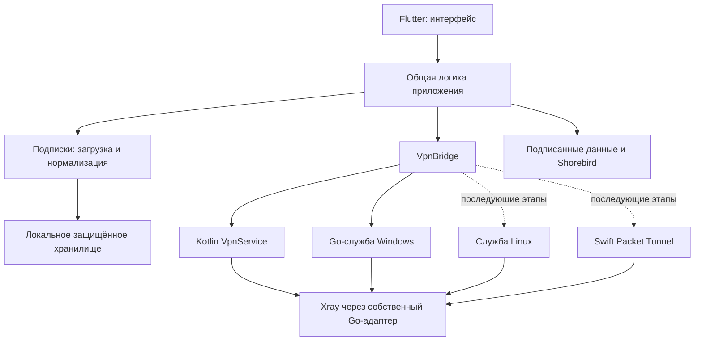

# ExVPN — архитектура

## Независимый Dart OTA, 2026-10-20

База 0.1.10+32 компилируется с `EXVPN_OTA_PROVIDER=exvpn` и fingerprint защищённых
native/assets/plugins/dependencies. Встроенный updater настроен на фиксированный
loopback endpoint; auto_update=false, strict RSA4096. Dart-адаптер держит socket
весь срок процесса, проверяет собственный Ed25519-каталог, срок/последовательность/
совместимость/ABI/отзыв, сохраняет high-water и проверяет diff до передачи SDK.
FFI выполняется последовательно вне UI isolate; timeout блокирует дальнейшие
SDK calls и сохраняет владение портом. Занятый порт отключает OTA, а не VPN.
Каталог и code assets публикуются раздельно, патчи неизменяемые; события SDK
не сохраняются и не пересылаются. Native proxy bypass касается только процесса.
Старые базы сохраняют прежнюю политику Shorebird Cloud; новый режим явный.
Это собственный совместимый адаптер, не официальный self-host Shorebird.
[Контракт и приёмка](INDEPENDENT_OTA_PLAN.md).

## Настройка Kill Switch и ограниченный журнал, 2026-10-20

Опциональный `ConnectionProtectionBridge` возвращает supported/nullable enabled/
active/systemManaged. Preference и фактические фильтры независимы; recovered guard
может оставаться активным при сохранённом OFF. Dart не оптимистично меняет флаг:
сериализует setter с connect/policy/restart, отсекает поздние чтения и перечитывает
ОС при возврате приложения. Ошибки этой настройки отделены от состояния туннеля.
Windows OFF использует owned dynamic WFP lifetime с теми же live block/loopback
правилами, ON — прежние persistent filters. Только полностью disconnected setter;
новая DPAPI owner-bound preference по умолчанию ON, ошибки хранения запрещают новый
VPN. Core, DNS, owner routing и direct fallback не меняются. Android читает только
публичные флаги живой VpnService; при неизвестном состоянии не обещает блокировку.
Изменения — через системные VPN Settings с действием пользователя, без fake switch.
Новые native методы требуют новой подписанной базы; текущие runtime gates открыты.

`ClientLogs` живёт с приложением, только в памяти: до 64 событий, TTL 30 минут,
очистка каждую минуту и вручную. Записываются изменения типизированного состояния,
не stats ticks; schema2 содержит прежний schema1 diagnostics и bounded события.
Закрытый allowlist повторно проверяется при экспорте, лимит UTF-8 64 KiB; секреты,
подписки, имена, endpoint, raw exception и содержимое трафика не принимаются.
Копирование строит свежий отчёт по явному нажатию. Диск и внешняя отправка отсутствуют.
[Критерии/границы](evidence/settings-protection-logs.json).

## Локальная автоматическая группа серверов

Connect/reconnect могут содержать `automaticProfiles`: 1–32 уникальных
нормализованных профиля, выбранных пользователем. Основной профиль должен
полностью совпадать с членом группы. Каждый кандидат валидируется закреплённым
ядром; provider routing/DNS/burstObservatory не становятся локальной политикой.
Windows SCM и Android VpnService самостоятельно наблюдают фиксированную
HTTPS-проверку и при разрешённых транспортных отказах заменяют сервер,
сохраняя persistent guard/TUN. После полного неудачного обхода — пауза 30 с.
Security/config/storage/unknown ошибки прекращают перебор. Состояние
`automaticSelection` авторитетно у native, Dart не запускает параллельный
supervisor. `clearAutomaticSelection` отменяет будущие замены, сохраняя туннель.
Проверки epoch/generation не допускают позднего подключения после ручного
выбора/отключения. [Контракт и границы](SUBSCRIPTION_COMPATIBILITY_AND_FAILOVER.md).
Это ordered primary/backup, не эмуляция `leastLoad` или `roundRobin`.

Windows: неудачная HTTPS-проверка полностью запущенного кандидата автоматической
группы сохраняет этот core/TUN и разрешение WFP на время cooldown. Подтверждённые
исключения продолжают прямые соединения; защищённый трафик и DNS не получают
direct fallback. Это состояние blocked/reconnecting, а не connected.
Удержание разрешено только для распознанного удалённого/транспортного отказа,
живого context/generation и неизменившегося underlay. Ошибки guard/lease,
неизвестные ошибки и отмена закрывают core с сохранением persistent deny.
При замене кандидатов Windows может пересоздать адаптер; непрерывным является
guard, а не обещание отсутствия краткого разрыва TUN. Runtime-приёмка ведётся
отдельно от этих source-регрессий (`ec0e865`, `12c2caa`).

## Дополнение: CI-подготовка Dart-патчей

Workflow `shorebird.yml` разделяет no-build `diagnose_android` и signed patch
matrix. Android preflight проверяет полный synthetic ZIP inventory для двух
форматов SDK; временная папка задаётся только дочернему анализатору и удерживается
по file ID. Signing/API secrets диагностическому job не передаются.

Patch wrapper проверяет неизменную базу и полный filemap, затем временно
использует точные bytes двух известных текстовых assets своей платформы.
Допустимо только эквивалентное изменение LF/CRLF; HEAD/base/checkout/artifact
должны совпадать по нормализованному содержимому. Bytes/mtime/index восстанавливаются
через `finally`. Остальные asset/native/dependency/signing/SDK изменения
отклоняются; штатные upstream diff checks остаются включены.
Та же граница LF/CRLF применяется отдельно к checkout-представлению фиксированного
Shorebird lock-файла: HEAD/base/checkout должны иметь одинаковое содержимое,
а временные bytes — точный SHA из base runtime evidence. Значения pin и Git blob
остаются прежними; строгая runtime-проверка не подменяется сравнением версий.

На Windows свежий CRLF checkout может отличаться от принятого Android seal
по представлению строк. Поэтому Android подготавливает единый ограниченный
набор: 22 фиксированных seal pins и два известных assets. Полный план проверяется
до первой записи; допустим только LF/CRLF-вариант того же HEAD/base blob с точным
SHA из запечатанной базы. Этот набор удерживается от notice verifier до конца
штатного Gradle/patch вызова. Проверки seal, JNI, runtime и upstream diffs остаются
строгими. Исходные bytes/mtime и логический Git index восстанавливаются перед
заключительным source guard, в том числе при ошибке. Изменения содержимого
этих 22 файлов требуют новой базы; исключений из source guard нет.

Для CI-only изменений переиспользуется конкретный принятый Full при равенстве
всех Dart lib/test входов; новый Dart запускает соответствующие app/package
проверки. `patch_target` позволяет повторить одну неуспешную платформу, сохраняя
фактические разные patch numbers. [Контракт и запуск](SHOREBIRD.md).

## Дополнение: реальная Shorebird-база и Dart-патчи 0.1.8+29

Cloud registration, приёмка установочного пакета, применение Dart-патча и
публичная доставка проверяются раздельно. У баз C7 (`5bddc777`) release **908884**,
strict RSA public pin и `auto_update: false`. Подписка не изменяет ключи или track.

Windows receipt сохраняет различие: `compiledSourceCommit=e8cba9fc…` для
восстановленных 283 cloud UI files и `sourceCommit=5bddc777…` для упаковки.
Эквивалентность компилируемых входов доказана до recovery; свежие service/helper
bytes привязаны к собственному payload. Android `compiledSourceCommit` и
`sourceCommit` равны C7. После успешного единственного upload Android упаковка
завершена отдельным audit/promotion хвостом над неизменными APK/AAB и свежими
JVM XML. Повторного Flutter build/upload в этом хвосте не было.

Базовые AOT, движок, JNI, APK signer, notices, SBOM и полные filemaps проверены;
резервные деревья сохраняют те же receipts и sealed patch inputs. Совместимый
патч source `0d9fdf22` прошёл строгий guard Dart-only без native/assets overrides.
У одной версии базы номера различаются по платформам: Windows **1 / 731624**,
Android **2 / 731631**; rollback обязан учитывать оба фактических номера.

Серверный beta/stable ответ и проверка RSA не заменяют runtime. Actual cold
restart подтвердил current/next Windows **1/1**, Android **2/2** и `uiRevision=1`
при прежних базовых пакетах и данных. На Android один изменённый байт cached AOT отвергнут native проверкой подписи
до загрузки. Полное SDK state/cache восстановлено с bytes/owner/mode/SELinux/
pointers/tombstones, затем снова подтверждён patch2/ui1. Облачный rollback обоих
номеров и холодный запуск подтвердили полный цикл `uiRevision` **0→1→0**. Null/base snapshot
сам по себе этого не доказывает. Native/engine/plugin/asset изменения требуют
нового полного базового пакета. E1 и стабильная VPN-приёмка — отдельные gates.

[Runtime gate](evidence/shorebird29-runtime-qa.json), [roundtrip](evidence/shorebird29-roundtrip.json).
Неизменные принятые пакеты могут переноситься в CI по hash/filemap; происхождение
`local_accepted_import` сохраняется отдельно от CI compilation.
Публикация тех же bytes выполнена workflow39294754335; runtime QA canonical
projection и её public SHA связаны release manifest. Оба Ed25519 full-update
feed указывают на проверенные публичные APK/EXE.
[Проверка доставки](evidence/release-v0.1.8.json).

## Дополнение: восстановление упаковки Shorebird-базы, 2026-10-19

Успешная регистрация базы в Shorebird и приёмка установочного пакета — разные
события. После ошибки упаковки запрещён автоматический повтор release/upload.
Сначала читается облачная запись; исходный архив восстанавливается по заранее
зафиксированным release/artifact ID, hash и size. Для Windows0.1.8 это сохраняет
уже собранные UI bytes. Receipt отдельно хранит compiledSourceCommit и
sourceCommit упаковки. До восстановления проверяется эквивалентность всех
компилируемых входов; допустимы только точные изменения упаковки и сохранения
байтов notice-pin, а SDK, ключи, native, Dart и assets обязаны совпасть.
Непроверенный recovery не разрешает распространение или patch workflow.

## Дополнение: выпуск 0.1.6+27

Обновление подписки автоматически принимает >=1 поддерживаемый профиль, если
все остальные записи относятся только к unsupportedProtocol/unsupportedFeature
или ignoredLocalConfiguration. Такие пропуски не создают предупреждений UI.
Ошибки формата/параметров, пустой результат и отказы загрузки сохраняют прежний
рабочий список; UI показывает значок реального отказа. Метаданные, source и
ревизия меняются атомарно с принятым списком. Явный legacy partial API сохранён.
Просмотр пользовательского имени отделён от вкладок; уход из Link отменяет
отложенный lookup и делает поздние ответы неактуальными. Native camera button
отключена до реализации; binary image clipboard native не обещается.

## Дополнение: автозаполнение формы, 2026-10-19

ImportDialog читает только корректную HTTPS-ссылку из текстового буфера при
открытии. Metadata lookup после500мс использует прежний bounded HTTPS-loader;
полученный документ кэшируется до изменения текста и повторно используется
при подтверждении. Revision отвергает устаревшие ответы. Ручное имя не затирается;
подставленное имя сохраняет происхождение automatic в controller. Изменение
выделения не создаёт новый запрос. До «Добавить» рабочий список не меняется.
QR sources разделены conditional export для native/web, без новых зависимостей.
[Подробности и текущие ограничения](QR_IMPORT.md). Бинарники этим UI-циклом
не обновлялись; platform runtime остаётся отдельной приёмкой.

## Дополнение: полные обновления Android и handoff Windows, 2026-10-19

Full backend теперь различает `exitUi` (Windows) и `installerOpened` (Android).
Только Windows сохраняет reservation до выхода UI; Android после сохранения
данных и открытия системного installer освобождает команды и оставляет retry.
Установка полного пакета на обеих платформах требует авторитетного idle VPN;
загрузка сама по себе не отключает соединение. Мобильная полоса обновления
закреплена над прокруткой, как и desktop strip.

Android использует отдельный Ed25519 domain/platform, фиксированный feed,
private atomic staging и независимую native проверку APK signer/package/version.
Доступ к cache/file URI не предоставляется подпискам. Открытие окна ОС не
считается успешным обновлением. [Контракт](ANDROID_APP_UPDATES.md).

Windows generation/validation staging используют один контракт: `handoff-`
и 16 случайных байт в canonical lowercase hex. Убрано неверное сравнение
общей длины с 39; строгие физические пути, ACL, source hash, owner identity и
двухфазный commit сохранены. [Диагностика](evidence/windows-update-0.1.5-diagnosis.json).

## Дополнение: подписки и системное согласие Android, 2026-10-18

Кандидат **0.1.4+25** использует `SubscriptionDocument`: отдельно недоверенное
название провайдера и исходный ограниченный документ профилей. Приоритет имени:
`profile-title` HTTP → метаданные тела → имя Content-Disposition. Пустое ручное
поле допустимо; fallback — «Подписка», без адреса или токена. Ручное имя сохраняется,
автоматическое меняется вместе с принятым списком; частичный кандидат не меняет
рабочее имя до принятия. Snapshot v2 хранит происхождение имени, читает v1;
старые имена считаются ручными. **Понижение на 0.1.3 и ниже не поддерживает v2**.
Нативное защищённое хранилище остаётся прежним непрозрачным журналом.

`VpnConsentCoordinator` владеет только одним запросом согласия: prepare перед
каждым connect/reconnect, уникальный token, отмена и игнорирование запоздалого
result, повторная prepare после RESULT_OK. Ожидание публикуется после запуска
системного Activity; focused/resumed проверка восстанавливает потерянный callback
и завершает неоткрывшийся запрос понятной ошибкой. Notification permission API33+
запрашивается отдельно и не выдаётся за VPN consent. Значки launcher/adaptive/
round/monochrome/notification используют существующую маску белки.

Runtime обнаружил, что `requestingPermission → error` оставлял консервативный
флаг возможного туннеля даже после отказа до старта службы. Исправлено:
только подтверждённое отсутствие service И pending-запроса публикует
`disconnected` с errorCode и без activeProfileId. Кнопка остаётся красной, но
следующее нажатие повторяет подключение. При существующем/неизвестном владельце
остаётся error и доступное явное отключение. Автоматический STOP не добавлен.

Blocked/error отображаются красным постоянным свечением большой кнопки.
Автоматического удаления защиты при ошибке нет; явное отключение остаётся
доступным. Ошибка обновления подписки доступна по её значку, без отдельной полосы
с повтором внутри списка. Дерево подписки — общий `SubscriptionTree`: отступ 24,
одна линия и короткие ветки без точек, естественная высота строк и RTL.

Нижние окна используют общий `ModalSheetScrollScope`. Прокрутка сначала
возвращает список к началу, затем передаёт потягивание контроллеру BottomSheet.
Закрытие за содержимое требует 30% высоты либо быстрого жеста; короткий/отменённый
жест возвращает окно. Поддержаны touch/stylus/invertedStylus/unknown, включая
типы ввода доступности, принимаемые стандартным Scrollable. Trackpad и колесо
не закрывают окно. Это локальное поведение modal builder, не глобальная замена
прокрутки приложения. Наблюдение API30 через ADB потребовало отдельной регрессии
unknown: обычный список прокручивался, а прежний touch-only handoff игнорировал
этот тип в widget-тесте. Точный kind реального release-события не измерялся.

## Дополнение: выбор приложений и отзывчивое подключение, 2026-10-18

Версия **0.1.3+24** расширяет локальную политику режимами disabled/exclude/include.
Собственные Windows/Android dispatchers разрешают прямой выход только после
проверки владельца; неизвестные процессы и DNS сохраняют VPN-маршрут. Галочки
сохраняются в выключенном режиме. Discord получает строгий постоянный family
anchor; нативные иконки загружаются отдельно и лениво.
Контроллер сериализует последний запрос; Android сохраняет TUN, Windows guard.
Техдетали обновлений доступны в явной обезличенной диагностике.
Android подтверждает appId в полном UID рабочего профиля и передаёт ядру также
известных невыбранных владельцев для include; system/self/isolated/shared mixed
остаются в VPN. Это исправляет выявленное runtime расхождение кандидата 0.1.2,
публикация которого была отменена.
[Контракт и границы проверки](APPLICATION_ROUTING.md).

## Дополнение: верхняя полоса и ошибки групп, 2026-10-18

`AppUpdateStrip` — presentation-only виджет высотой 24 px. Nullable
`HomeScreen.appUpdate`/`onAppUpdate` позволяют владельцу передать available,
downloading, restarting или failed. Полоса занимает всю ширину внутри того же
фиксированного canvas; padding перед меню 6 px. В downloading весь текст/иконка
заменены progress bar. После подтверждения дизайна production main подключён
к `AppUpdatesController`: полный Windows-пакет через отдельный Go helper либо
совместимый Shorebird-патч через общий Dart controller. Реальный прогресс
Windows основан на байтах; SDK без процента использует indeterminate bar.
Состояния ready/blocked не отключают VPN. [Контракт](WINDOWS_APP_UPDATES.md).

`design_preview.dart` отдельно симулирует загрузку и пересоздание HomeScreen,
сохраняя текущий формат, общий controller/выбор и appearance. Версия 0.1.1/build21
в Settings является явным параметром макета, не новой версией пакета.

SubscriptionRefresh.failed больше не включает глобальный индикатор сообщений.
Флаг/причина/повтор отображаются у группы, включая свернутое состояние. Реальные
ошибки хранилища и VPN сохраняют общие сообщения. Разбор и ошибка загрузки
разделены: parser issues показываются прежним диалогом, loader failure — отдельно.
Последний рабочий список и политика частичной замены не меняются.

Видимых кнопок темы три: dark/light/custom; persisted system читается для
совместимости и отображается через фактическую brightness. Locale null всё ещё
следует системе, но выбранное поле содержит endonym resolved языка, без второго
дубликата в меню. Пользовательский выбор меняет locale явно.

## Дополнение: дизайн, темы и языки, 2026-10-18

Текущий design-only цикл не меняет службы/туннель. Desktop canvas масштабируется
по ширине, с вычисляемой пропорциональной высотой и внешним ClipRect: округление
высоты окна больше не выбирает другую ось FittedBox. В минимальном формате
диаметр кнопки ограничен реальной доступной высотой с резервом для переключателей
и текущего узла; overflow не скрывается. Форматы находятся слева от неизменённого
по ширине/центру PROXY/VPN. Общий SlidingSegments используется для режима,
формата, темы и импорта ссылка/текст: gap 3, thumb 200 мс, клавиатура и reduced motion.

PowerButton разделяет декоративный IgnorePointer-слой и круглый ClipOval input.
Свечение не является областью нажатия; светлый/свой диск используют исходную
текстуру с сохранением блика. HeaderIconButton унифицирует glyph 20 и круглую
область 34×34 у настроек, minimize/close. Флаги — локальные assets 4:3, страна
берётся только из явных метаданных/Unicode-флага в названии; неизвестная — globe.

AppearanceController/Scope владеет выбором system/dark/light/custom, locale и
пятью ролями палитры background/surface/accent/glow/text. Несекретные настройки
пишутся отдельно от подписок; preview использует отдельный localStorage key.
Язык null следует platform locale; поддержаны ru/en/kk/de/fr/es/pt/tr/zh/ar,
неизвестный язык → en. Бренд, пользовательские имена и технические ID не переводятся.
Inter дополняют локальные Noto Sans SC/Arabic, без runtime font CDN.

Windows host в исходниках убирает OS caption через WM_NCCALCSIZE, сохраняет
resize border/DWM shadow и обычное tray-close поведение. Команды канала
exvpn/window: setLayout, startDrag, minimize, close, setColors. Child hit-test
передаёт только resize border родителю. Corner driver фиксируется один раз на
жест WM_ENTERSIZEMOVE, расчёт ведётся от стартового RECT; это устраняет смену
оси и накопление округлений. **Нативная сборка и приёмка рамки/resize/DPI в этом
цикле не запускались**, E2-013 открыт.

## Дополнение: Windows PROXY/VPN и переподключение, 2026-10-18

В 0.1.0+19 общий контракт дополняет `VpnMode`, `systemProxySupported` и
`cleanupRequired`; старый VPN-only bridge совместим. `ConnectionModeBridge`
предоставляет mode-aware connect/reconnect. Windows IPC строго проверяет
`mode`; служба владеет жизненным циклом HTTP/CONNECT и сохраняет WFP при
смене VPN-сервера. Bridge пользователя отдельно управляет WinINET с журналом
DPAPI и восстановлением прежних параметров. Android пока VPN-only.
[Поведение, безопасность и границы проверки](SYSTEM_PROXY.md).

## Дополнение: три формата Windows, 2026-10-18

`DesktopLayout` задаёт фиксированные логические холсты: minimal 400×440,
medium 440×760, large 1040×680. Общий `FittedBox` масштабирует всё содержимое
без перестановки блоков при растяжении. Режим выбирается тремя иконками по
центру шапки. Минимальный содержит кнопку и текущий узел снизу; средний —
прокручиваемые группы; большой — кнопку/сведения слева и список справа.
Таймер передаётся в `PowerButton.elapsedLabel`; подписи под кнопкой удалены.
Замечания подписки доступны по значку перед количеством соединений.

Windows host принимает `exvpn/window.setLayout` с одним именем режима,
учитывает DPI/рамку, сохраняет пропорцию client area при `WM_SIZING` и
помещает окно в рабочую область. Максимизация отключена. По следующему
поручению пользователя новый host собран 2026-10-18 в локальном Windows
release-комплекте 0.1.0+18; полная приёмка размеров/DPI остаётся в E2-007.

Изолированный `design_preview.dart` использует те же widgets и только
синтетическую визуальную симуляцию; production `main.dart` его не импортирует.
Симуляция не подтверждает VPN и не включается в обычном приложении.
Методика: [DESIGN_PREVIEW.md](DESIGN_PREVIEW.md).

Уточнение UI 2026-10-18: refresh обновляет все URL-группы (не более трёх
загрузок параллельно), ошибки выводятся очередью коротких уведомлений сверху.
Защита последнего рабочего списка и явная проверка частичных данных сохранены.
`ServerLatencyController` держит отдельные временные результаты по profile ID;
`ServerEntry.latencyMs` остаётся только синтетическим полем макета.
Новый native TCP probe не использует прежний active-tunnel `VpnBridge.probe`:
он измеряет endpoint отдельно, не переключая VPN и не передавая пользовательские
данные. UDP-only варианты получают unsupported. Дедлайн не освобождает
глобальный слот зависшего DNS до фактического завершения, поздний DNS не
открывает соединение; предел — четыре операции. Реальная сеть ещё не проверена.
Отключённая PowerButton сохраняет исходный цвет диска; символы Space Gray,
без hover-свечения. Последнее уточнение пользователя отменяет затемнение диска.

Малый режим открывает локальный модальный выбор внутри масштабируемого холста:
выбор/X/Escape закрывает его без `setLayout`, фон исключён из фокуса и семантики.
Шапка «Серверы» с действиями находится вне прокручиваемых групп в medium/large
и модальном выборе. Диалог замечаний теперь только кратко объясняет причину
и сохраняет предыдущий список; частичное обновление из него не применяется.

Локальный `scripts/design/update-installed-ui.ps1` предназначен только для
этого design-цикла установленной 0.1.0+18. Он проверяет исходный/установленный
manifest, защищённые ACL и оба mutex; сохраняет CRT/engine и полный предыдущий
UI/state, обновляет `trees.ui` и отдельную `uiRevision`. Служба, её разрешённый
путь клиента, данные пользователя и сеть не меняются. Обычные ошибки возвращают
предыдущие файлы. Переименование UI и замена install-state атомарны по отдельности;
при потере питания между ними нужен разбор защищённого журнала до обслуживания.
Это локальный инструмент, не механизм выпуска или OTA.

## Дополнение: HWID-подписки

Начиная с 0.1.0+7 ограниченный HTTPS-загрузчик обрабатывает явный HWID challenge
до разбора тела. Один повтор того же URL входит в общий срок 15 секунд;
redirect и неподтверждённые TLS-сертификаты не разрешаются. Случайный секрет
установки защищён Android Keystore / Windows DPAPI. HMAC для HTTPS origin
разделяет провайдеров и не зависит от токена ссылки. Нет аппаратного fingerprint,
генерации нового ID при ошибке хранилища или импорта служебной записи вместо
подписки. Детали, тесты и совместимость: [PROVIDER_COMPATIBILITY.md](PROVIDER_COMPATIBILITY.md).

Проверка Windows 2026-10-16: TUN DNS использует отдельные peer-адреса
`172.31.255.2` и `fd71:6578:7670::2`, а не собственные IP адаптера: иначе Windows
доставляет DNS локально, минуя TUN. На изолированном диагностическом стенде
подтверждены HTTPS, TCP-исключение и сохранение WFP после аварии процесса.
Дополнительный Flutter integration test проверил эти отказы на установленной
SCM-службе; полная IPv6/DNS приёмка остаётся открытой. Подробности:
[WINDOWS_VALIDATION.md](WINDOWS_VALIDATION.md).

Дата: 2026-10-16. Это целевая архитектура, а не заявление о готовности всех компонентов. Реализованные и проверенные части перечислены в [CHECKLIST.md](CHECKLIST.md).

## 1. Компоненты и границы ответственности

Flutter не получает административных прав на Windows. Привилегии ограничены системным адаптером. UI не формирует произвольные команды службы и не управляет WFP напрямую. Ядро получает конфигурацию, построенную из проверенного внутреннего профиля и локальной политики.

Чистая логика парсинга и OTA отделяется от Flutter widgets и платформенных каналов, чтобы проверять её без подключения VPN. Системные адаптеры отвечают за жизненный цикл, доступ к TUN, защиту сокетов, DNS и платформенную защиту. Конкретный layout пакетов следует фактически созданному scaffold; эти границы обязательны независимо от расположения файлов.

### Реализованный UI-слой на 2026-10-16

По прямому поручению пользователя выбранный дизайн реализуется до завершения E1 без обещаний работающей защиты:

- `apps/exvpn`: Flutter-приложение, адаптивный главный экран, тёмная/светлая темы, сворачиваемые группы, выбор сервера, диалог импорта/обновления и удаление подписок.
- `packages/exvpn_client_state`: состояние групп/выбора, обработка импорта и строгий ограниченный codec снимка. Платформенное шифрование выполняет `SubscriptionStore`; модель сама не записывает файлы и не вызывает native VPN.
- `packages/exvpn_domain`: строгий парсер, нормализованные профили, снимок подписки и контракт `VpnBridge`.
- `apps/exvpn/lib/services/subscription_loader.dart`: HTTPS-only загрузчик с таймаутом 15 секунд на весь запрос, пределом 2 MiB по потоку, запретом редиректов и строгим UTF-8. Ошибка содержит только безопасный код; отмена действует при timeout, превышении размера и закрытии загрузчика. Проверка сертификатов остаётся платформенной. CORS/скрытые браузером отказы возвращают `network`.

Обычный запуск пустой. Демонстрационные подписки доступны только при `?demo=1` или `--dart-define=EXVPN_DEMO=true`; их задержки не являются измерениями. Нажатие подключения без профиля открывает импорт. На Android/Windows настоящий профиль передаётся через `NativeVpnBridge`; демонстрационные профили не запускают ядро. В браузере системный VPN недоступен. `VpnController` принимает фактическое состояние через native event stream, восстанавливает его при запуске/возвращении в приложение и игнорирует устаревшие ответы. Принятая команда никогда не считается успешным туннелем. Потеря IPC снимает подтверждение состояния, оставляя действие отключения.

Android содержит Kotlin foreground `VpnService`, TUN IPv4/IPv6, Go c-shared JNI, проверку protect/bind сокетов и HTTPS health-check. Использованы прямые API закреплённого Xray: стандартный dialer игнорировал ошибку protect, поэтому собственный dialer обязателен. libXray остаётся исследовательским кандидатом, не подключённой библиотекой Android. Windows содержит SCM Go-службу, строгий named-pipe IPC, persistent WFP latch и C++ Flutter host adapter. Подробные контракты/ограничения: `native/android/README.md`, `native/windows/README.md`. Android debug APK собран: семь вариантов протоколов, ошибочный REALITY ключ, UID-исключение и часть lifecycle проверены в эмуляторе API36. Visual Studio C++/CMake/Windows SDK установлены; Windows release/NSIS собраны, clean-checkout CI Android/Windows прошёл. В Sandbox проверены установка, семь вариантов протоколов и отказ установленной SCM-службы; вся матрица приёмки остаётся открытой. Подробности: `ANDROID_VALIDATION.md`, `WINDOWS_VALIDATION.md`. Это ещё не подтверждение полной системной защиты или выпуска.

Общие каналы: `exvpn/vpn`, `exvpn/vpn_state`, `exvpn/vpn_stats`. UI показывает реальные версии, таймер и доступные счётчики; недоступные измерения не заменяются фиктивными данными. Исключения читаются из backend через `getExclusions`, меняются только при остановленном сеансе. Настройки защиты открывают системную страницу Android; флаг `processCrashProtection` не устанавливается интерфейсом.

Windows SCM сохраняет подтверждённые исключения в фиксированном HKLM64-ключе,
привязанном к installer owner SID. Protected DACL допускает только SYSTEM/admin;
DPAPI работает в пользовательском контексте LocalSystem, без machine-wide decrypt.
Сохранение и connect сериализованы, запись/flush предшествуют подтверждению.
Ошибка чтения не создаёт пустую политику; требуется явный сброс при отключённом
VPN. Сохранение настроек после аварии подтверждено на +4; guard остаётся blocked.
Контракт, отказы и доказательства: [WINDOWS_POLICY.md](WINDOWS_POLICY.md).

Начиная с +6 LocalSystem-служба перед открытием IPC выдаёт привязанному owner SID
только `PROCESS_QUERY_LIMITED_INFORMATION` на собственный процесс и проверяет
DACL обратно. Это позволяет обычному UI проверить реальный executable/PID
сервера по SCM; права управления процессом не выдаются. Ошибка ACL останавливает
запуск службы. Проверка из medium token и её ограничения описаны в
[WINDOWS_UNELEVATED.md](WINDOWS_UNELEVATED.md).

## 2. Контракты общей части

### Windows tray

В +14 Win32 shell адаптер передаёт фиксированные команды в
`DesktopTrayController`, который использует тот же `VpnController`, что окно.
Он не обращается к службе отдельным привилегированным каналом. Перед Connect
проверяются актуальная native-фаза disconnected и неизменный выбранный профиль.
Close скрывает окно, не меняя VPN; явный выход из UI подтверждается после
пояснения о продолжающей работать службе и завершает сохранение подписок.
Shell получает только фазу/доступность команд, без профилей и адресов.
Контракт и незакрытая runtime-приёмка: [WINDOWS_TRAY.md](WINDOWS_TRAY.md).

### Владение транспортами ядра

Для +11 закрепляется собственный lifecycle patch Xray поверх исходного
`701af60772cda123492f86e383e1fdba066614a9`. Parsed stream configuration
владеет gRPC/XHTTP кешами, активными соединениями и отменой начатых запросов.
`Handler.Close` завершает этого владельца; независимый экземпляр ядра продолжает
работу. Сокет остаётся у dial callback до успешной передачи, в том числе при
ошибке TLS/REALITY или возврате `(conn, err)`. Windows lease дополнительно
сохраняет границы поколения для системных сокетов.

Исходный модуль, patch и изменённый module ZIP закреплены хешами. Сборка
реконструирует отдельную неизменяемую версию через локальный Go proxy; внешний
`replace` и изменение исходного кеша зависимостей не используются. В пакет
включаются точные MPL-исходники и сведения о модификациях.
[Контракт, регрессия и платформенная приёмка](XRAY_LIFECYCLE.md).

Windows +12 закрывает существующее ядро до отзыва динамических WFP permits,
сохраняя persistent block. Suspend выполняется и при ошибке Close; при любой
ошибке очистки владелец не теряется, replacement/Disarm запрещены. Shutdown
сериализован с решением явного Disconnect снять latch. Поведенческие проверки
и границы runtime-доказательства описаны в том же документе.

В `exvpn.4` TUN inbound получает собственный отменяемый контекст. Close и
ошибка частичного запуска сначала отменяют его, затем завершают UDP-обработчики
и освобождают стек/TUN. Новый пакет после закрытия не создаёт UDP-сеанс;
независимые inbound-контексты не отменяются. Параллельные Close ожидают одну
очистку и получают сохранённые ошибки. Это исправляет воспроизведённое удержание
DNS-обработчика, но само по себе не доказывает ограниченность всех ресурсов ОС.

### VpnBridge

Общий мост предоставляет следующие операции и наблюдения:

| Операция | Назначение |
|---|---|
| `connect(profile, policy)` | Проверить возможности/разрешение и подключить выбранный профиль с локальной политикой |
| `disconnect()` | Выполнить явное отключение; вернуть фактическое состояние защиты |
| `watchState()` | Поток состояния, выбранного профиля и обезличенной причины ошибки |
| `watchStatistics()` | Счётчики входящих/исходящих байт и длительность подключения |
| `probe(profile)` | Отдельный ограниченный сетевой тест; различать задержку и подтверждённую туннельную доступность |
| `listApplications()` | Платформенно доступные приложения для настройки исключений |
| `setExclusions(applications)` | Проверить и применить поддерживаемые локальные исключения |
| `getCapabilities()` | Фактическая поддержка исключений, системной защиты и перехода в настройки ОС |

Названия таблицы задают семантику; конкретные типы должны быть общими и типизированными, с версией контракта для IPC. Native adapter возвращает различимые ошибки разрешения, разбора профиля, запуска ядра, подключения, DNS, IPC и несовместимой возможности. UI не выводит сырой stack trace/конфиг ядра.

Состояния: `disconnected`, `requestingPermission`, `connecting`, `connected`, `reconnecting`, `blocked`, `error`. `connected` выставляется по фактической готовности адаптера и туннеля, а не сразу после нажатия кнопки. Потеря транспорта переводит в восстановление или блокировку, не в состояние с прямым fallback. После перезапуска UI запрашивается состояние работающей службы; UI не является источником истины о VPN.

Повторные команды сериализуются адаптером. Устаревший ответ предыдущей попытки не может заменить состояние нового подключения. Отключение отменяет выполняемую попытку; восстановление не должно самопроизвольно отменять явное решение пользователя отключиться.

### Нормализованный профиль

В development +8 добавлены строго проверяемые VLESS Encryption и один TCP
Sudoku mask. Дополнительные поля включены в ID, native JSON и защищённый
снимок; старые ID сохранены. Грамматика, ограничения и реальные результаты:
[VLESS_ENCRYPTION.md](VLESS_ENCRYPTION.md). Sudoku не заменяет аутентификацию
peer; arbitrary FinalMask/routing/stream configuration по-прежнему запрещены.

Внутренний профиль содержит стабильный локальный ID, ссылку на подписку, отображаемое имя, протокол, адрес/порт, учётные данные и проверенные параметры транспорта/TLS/REALITY. Ключи и пароли остаются в защищённом хранилище и передаются ядру только локально. Отображаемые имена считаются недоверенным текстом.

Начальные протоколы: VLESS, VMess, Trojan, Shadowsocks, Hysteria2. REALITY и XHTTP — параметры безопасности/транспорта соответствующего протокола; матрица совместимости проверяется на закреплённом Xray. Неизвестный параметр не должен превращаться в незаметное ослабление TLS или иной режим транспорта.

Результат импорта содержит поддерживаемые профили и обезличенные проблемы отдельных записей. Для неизвестных схем и неверных типов данных возвращаются причины. Неверное значение не «исправляется» преобразованием в менее безопасный режим.

## 3. Подписки и хранилище

Конвейер: `ввод → ограниченная загрузка HTTPS → определение формата → строгий разбор → нормализация → проверка возможностей → атомарное сохранение`.

- Форматы: отдельные URI/списки, Base64-списки и поддерживаемые outbound-профили Xray JSON.
- Импорт Xray JSON извлекает только допустимые поля профилей. Inbounds, routing, API, executable hooks, пути файлов и источники обновлений провайдера не исполняются и не становятся локальной политикой.
- HTTPS проверяет сертификат; обход проверки TLS не используется для решения тайм-аута тестовой подписки. Время, размер ответа и число записей ограничиваются, ошибки не включают URL с токеном.
- Повторное обновление не уничтожает последний рабочий набор при сетевой ошибке, неправильном формате или отсутствии поддерживаемых профилей.
- Частичный результат показывает, какие записи не поддерживаются; пользователь видит деградацию вместо молчаливого пропуска.
- Обновление запускается вручную и при старте для подписок старше шести часов; параллельные обновления одной подписки объединяются.
- Несколько подписок изолированы. Удаление одной не затрагивает остальные; выбранный профиль после обновления сопоставляется со стабильной идентичностью.

Платформенное защищённое хранилище защищает секреты подписок и учётные данные: Android Keystore, Windows DPAPI/эквивалентный платформенный механизм, затем Apple Keychain и Linux Secret Service. Выбор конкретной библиотеки фиксируется с лицензией и проверкой поведения; отсутствие защищённого backend не приводит к сохранению секретов открытым текстом.

Реализованы вставка текста, ручное обновление и автоматическое обновление сохранённых HTTPS-источников при запуске после шести часов. Одновременные HTTP-запросы одной группы объединяются; монотонная `contentRevision` не позволяет запоздалому ответу или ошибке заменить результат ручного изменения даже в ту же миллисекунду. Сворачивание группы не отменяет загрузку. Смена списка не переподключает активный VPN автоматически.

Частичный ответ для непустой группы сохраняет рабочие профили, источник и дату.
Нормализованный кандидат остаётся только в памяти; интерфейс показывает число
поддерживаемых подключений, индексы записей и фиксированные причины без сырых
URI/исключений. Замена всего списка требует явного подтверждения именно этого
кандидата и исходной `contentRevision`. Новый запрос отменяет старое подтверждение
ещё до загрузки; удаление группы, другой результат и поздний HTTP не позволяют
применить устаревший список. Автообновление не подтверждает частичный ответ.
После перезапуска сохраняются принятые профили и безопасные причины, но для
подтверждения нового списка его нужно получить заново. При отсутствии хотя бы
одного поддерживаемого профиля заменить рабочий список нельзя.

`SubscriptionStore` хранит ограниченный нормализованный снимок через Android Keystore и собственный Windows DPAPI backend. Журнал `pending/current` проверяется чтением перед фиксацией; Windows заменяет только шифрованные файлы атомарно. Удалённая подписка не восстанавливается из исторической backup-копии. Ошибка загрузки отключает автоматическую запись этого сеанса и явно показывается: пустой UI не перезаписывает ранее сохранённые данные. Очередь сохранения сериализована, импорт и удаление ожидают её завершения. Детали и границы испытаний: [SECURE_STORAGE.md](SECURE_STORAGE.md). QR из PNG/JPEG реализован с подтверждением и ограничениями ресурсов; Android picker/импорт/перезапуск проверены, Windows picker/cancel проверены, полный Windows импорт и матрица аварий диска остаются открытыми. См. [QR_IMPORT.md](QR_IMPORT.md).

## 4. Системные адаптеры и политика трафика

### Android 11+

Kotlin `VpnService` получает системное согласие пользователя, создаёт TUN и работает как foreground service с обязательным уведомлением. Socket protection предотвращает петлю: подключения ядра к удалённому серверу не попадают обратно в TUN. Ядро и TUN имеют согласованный жизненный цикл независимо от Flutter Activity.

Все пользовательские приложения захватываются TUN. Исключения сохраняются как package names; при запуске разрешаются в актуальные UID. Классификация владельца через Android process hook Xray проверяется на реальном устройстве; общий/неизвестный UID не должен обходить VPN из-за неоднозначности. `addDisallowedApplication` не используется для согласованной схемы lockdown.

Защита при аварии сервиса требует системного Always-on и Block connections without VPN. ExVPN объясняет этот статус и открывает настройки; не заявляет, что может самостоятельно включить/выключить системную политику. При явном отключении в lockdown интерфейс показывает, что блокировка ОС может остаться активной.

### Windows 10/11 x64

Flutter UI общается с Go-службой по локальному версионированному IPC. Доступ ограничивается ACL ожидаемого локального пользователя и проверкой клиента; нельзя давать произвольному процессу управление маршрутами, executable paths ядра или фильтрами. Служба принимает только типизированные команды и проверяет payload независимо от UI.

Служба управляет ядром, TUN, маршрутами и DNS; фиксирует только принадлежащие ExVPN изменения для восстановления. WFP-фильтры сохраняются после падения службы и применяются до открытия защищаемого трафика. Разрешённый транспорт самого ядра не превращается в универсальный обход для других процессов.

Для endpoint с доменным именем служба выполняет ограниченный DoH после установки persistent guard, до запуска TUN. Отдельное временное WFP-разрешение ограничено executable службы, SYSTEM, `1.1.1.1:443`/TCP и выбранным внешним интерфейсом. Проверенные A/AAAA передаются как внутреннее точное static mapping с `ForceIP`, без замены SNI/Host; перед запуском TUN bootstrap-разрешение закрывается. Системный DNS не используется как fallback. Кеш между подключениями отсутствует; автоматическое обновление снимка по TTL/смене сети ещё открыто. [Реализация и границы проверки](WINDOWS_DNS_BOOTSTRAP.md).

Исключения определяются точным нормализованным executable path и подтверждённым владельцем потока. Совпадение только имени файла недостаточно. Изменение пути/удаление приложения не должно расширять исключение.

Отключение, обновление и uninstall удаляют только ресурсы ExVPN. При ошибке восстановления пользователь получает явный статус и возможность восстановления, а не скрытую очистку всего firewall. Системные тесты выполняются в управляемом стенде с документированной процедурой восстановления сети.

### Общие инварианты

- Неизвестный владелец соединения направляется через VPN или блокируется.
- Сбой сервера не вызывает прямой доступ защищаемых приложений.
- Сбой ядра может временно блокировать исключения; это ожидаемое безопасное поведение.
- DNS следует безопасной политике; неизвестная принадлежность не является основанием для прямого DNS.
- IPv6 поддерживается полностью или блокируется безопасно и явно; отсутствие IPv6-маршрута не допускает обхода.
- Изменение сети, sleep/resume и перезапуск UI не оставляют окно прямого выхода.

### Linux и iOS

Linux использует общую логику и отдельную службу с минимальными полномочиями. Маршруты, DNS, упаковка и отключение проверяются на Ubuntu 22.04/24.04.

iOS использует Packet Tunnel extension с ограниченным системным жизненным циклом. Нужны macOS/Xcode, Apple signing и entitlement. Consumer iOS не получает обещания произвольных исключений установленных приложений; доступные возможности определяются платформенным адаптером и показаны в UI.

## 5. Версии и OTA

Разделены четыре идентичности: SemVer приложения + возрастающий build number, закреплённая версия/commit ядра, ревизия ресурсов и номер Dart-патча. Совместимость проверяется до скачивания/применения, без сравнения произвольных строк версий как текста.

### Подписанные данные

Manifest подписывается Ed25519 и описывает ревизию, поддерживаемые версии приложения, файлы, размеры и SHA-256. Проверяется подпись точных подписанных байтов; доверенные публичные ключи входят в приложение. Подписка провайдера не может изменить доверенный ключ или источник manifest.

Файлы скачиваются во временный каталог, проверяются по размеру/хешу, затем весь набор атомарно активируется. Запрещены выход из каталога, абсолютные пути и выполнение содержимого как кода. Изменения не применяются к активному VPN-сеансу до безопасной точки. Обрыв, неверная подпись, нехватка места или несовместимость сохраняют рабочую ревизию. Откат — новая подписанная ревизия с предыдущим содержимым; локальный последний рабочий набор сохраняется для восстановления.

Библиотека `packages/exvpn_updates` реализует проверку подписи точных байтов,
ограниченный HTTPS, SHA-256, staging и атомарный commit-marker. Есть отдельные
`stage/activate/cancel/recover`, восстановление предыдущего набора и монотонная
ревизия. Владельцем записи остаётся один Dart isolate; независимые клиенты и
процессы отклоняют конкурирующую запись без бесконечного ожидания. Пройдены 24
runtime-теста, 7 тестов офлайн-подготовки и анализ. Flutter native-интеграция
реализована; HTTPS-доставка отдельного QA-пакета и откат новой ревизией проверены
в Android-эмуляторе. Production endpoint/keys, Windows native OTA и полная
аварийная приёмка остаются открытыми; детали: [DATA_UPDATES.md](DATA_UPDATES.md).

### Dart и полные выпуски

Shorebird предназначен для подписанных исправлений Dart в пределах совместимого
базового выпуска; изоляция beta/stable является отдельным критерием приёмки.
В +15 добавлен ручной updater на закреплённом SDK 2.0.7. Канал задаётся при
сборке, `auto_update: false`; SDK работает вне UI isolate. Current/next patch
читаются отдельно, null next при ненулевом current означает подготовленный
откат к базе. Переданная SDK ошибка чтения и отсутствие engine не означают patch 0.
При этом native C API закреплённого updater возвращает `0` также при внутренней
ошибке чтения: по одному значению current/next и надписи «Базовый выпуск»
нельзя подтвердить корректную native-конфигурацию. Это отдельное ограничение
локальной проверки; E6 требует реальной доставки и отката подписанного патча.
Updater не перезапускает приложение или VPN; долгий вызов сохраняет блокировку
повторной операции до фактического завершения. Проект создан, doctor 6/6 PASS;
подпись патчей и реальный цикл release/update/rollback ещё требуют проверки.
Детали и границы: [SHOREBIRD.md](SHOREBIRD.md).

База +16 собирается отдельным закреплённым Shorebird SDK и содержит свой
проверенный engine; обычный Flutter-пакет не становится OTA-совместимым после
одного добавления Dart dependency. Встроены `patch_verification: strict`,
`auto_update: false` и public key beta-патчей. Ключ RSA патчей отделён от
Android signer и Ed25519 данных. Локальный build wrapper выполняет только
dry-run, сверяет исходный lock и упакованную policy, сохраняет точные хеши
пакетов. Публикация и runtime-приёмка патчей — отдельные шаги после проверки.
Закрытые ключи остаются в `.private/signing` под ACL/DPAPI; до стабильного
распространения требуется переносимая защищённая копия с проверкой восстановления.

Нативное ядро, plugins, Flutter engine, разрешения и встроенные assets требуют
обычного выпуска. Отдельные управляемые ресурсы могут идти через канал данных.

Первоначальный APK и полные обновления подписываются одним сохранённым ключом и устанавливаются системным установщиком. Windows NSIS управляет службой и обеспечивает корректный upgrade/uninstall. Ключи подписи не входят в репозиторий; CI получает их защищённым способом.

Доставка патча считается готовой только после реального release → patch → update → rollback на целевом устройстве. Наличие SDK или mock не закрывает E6.

## 6. Диагностика и проверка

Пользовательская диагностика содержит версию приложения/ядра, платформу, обезличенное состояние, коды ошибок и результаты проверок. Не включает URL подписок, credentials, destination names/IP из пользовательского трафика или полный конфиг. Экспорт проходит ту же очистку, что UI/CI-логи.

Синтетические fixtures проверяют URI/JSON/Base64, ошибки типов, неизвестные поля, IPv6-адреса и кодирование. Системная приёмка отдельно проверяет HTTPS/IP, владельца потока, DNS с холодным кешем, UDP, IPv4/IPv6, смену сети и аварии. Макеты, анализ кода и тесты генерации конфигурации не подменяют эти доказательства.

Отдельный release gate проверяет отсутствие секретов, комплект лицензий, подписи, обновление с предыдущей версии и восстановление состояния ОС после удаления. Источники решений и этапы: [PLAN.md](PLAN.md).

Windows UI↔native↔SCM проверяется отдельным bundled Flutter `integration_test`
entry point. QA executable находится в отдельном защищённом каталоге; production
service binary, owner SID и IPC-проверки сохраняются. После прогона возвращается
точный production client path службы. Нет HTTP/VPN mocks; только IME для ввода
тестовой подписки синтезируется внутри Flutter. Установщик и lifecycle запускаются
через CLI Sandbox без Computer Use; хостовая сеть не изменяется. Этот прогон не
подменяет physical-device, native-dialog, полную leak/lifecycle, storage и OTA acceptance.
Отдельный fault coordinator останавливает собственный fixture, аварийно завершает
SCM-службу гостя и запускает её снова. Два точных executable проверяют HTTPS
одновременно; команды имеют фиксированный порядок и nonce. После явного
восстановления сравниваются route/DNS hashes и отсутствие TUN/WFP guard.
Схема запуска и доказательства — [WINDOWS_AUTOMATED_QA.md](WINDOWS_AUTOMATED_QA.md).
