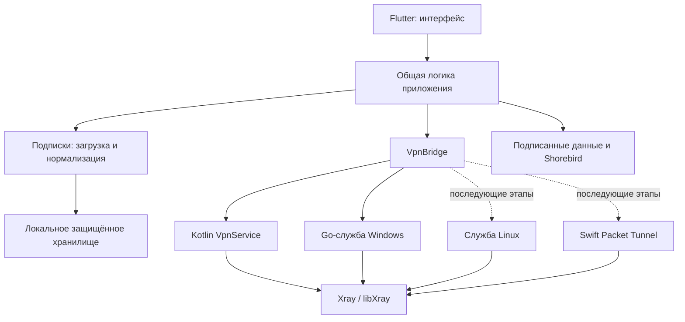

# ExVPN — архитектура

Проверка Windows 2026-10-16: TUN DNS использует отдельные peer-адреса
`172.31.255.2` и `fd71:6578:7670::2`, а не собственные IP адаптера: иначе Windows
доставляет DNS локально, минуя TUN. На изолированном диагностическом стенде
подтверждены HTTPS, TCP-исключение и сохранение WFP после аварии процесса.
Дополнительный Flutter integration test проверил эти отказы на установленной
SCM-службе; полная IPv6/DNS приёмка остаётся открытой. Подробности:
[WINDOWS_VALIDATION.md](WINDOWS_VALIDATION.md).

Дата: 2026-10-16. Это целевая архитектура, а не заявление о готовности всех компонентов. Реализованные и проверенные части перечислены в [CHECKLIST.md](CHECKLIST.md).

## 1. Компоненты и границы ответственности

Flutter не получает административных прав на Windows. Привилегии ограничены системным адаптером. UI не формирует произвольные команды службы и не управляет WFP напрямую. Ядро получает конфигурацию, построенную из проверенного внутреннего профиля и локальной политики.

Чистая логика парсинга и OTA отделяется от Flutter widgets и платформенных каналов, чтобы проверять её без подключения VPN. Системные адаптеры отвечают за жизненный цикл, доступ к TUN, защиту сокетов, DNS и платформенную защиту. Конкретный layout пакетов следует фактически созданному scaffold; эти границы обязательны независимо от расположения файлов.

### Реализованный UI-слой на 2026-10-16

По прямому поручению пользователя выбранный дизайн реализуется до завершения E1 без обещаний работающей защиты:

- `apps/exvpn`: Flutter-приложение, адаптивный главный экран, тёмная/светлая темы, сворачиваемые группы, выбор сервера, диалог импорта/обновления и удаление подписок.
- `packages/exvpn_client_state`: состояние групп/выбора, обработка импорта и строгий ограниченный codec снимка. Платформенное шифрование выполняет `SubscriptionStore`; модель сама не записывает файлы и не вызывает native VPN.
- `packages/exvpn_domain`: строгий парсер, нормализованные профили, снимок подписки и контракт `VpnBridge`.
- `apps/exvpn/lib/services/subscription_loader.dart`: HTTPS-only загрузчик с таймаутом 15 секунд на весь запрос, пределом 2 MiB по потоку, запретом редиректов и строгим UTF-8. Ошибка содержит только безопасный код; отмена действует при timeout, превышении размера и закрытии загрузчика. Проверка сертификатов остаётся платформенной. CORS/скрытые браузером отказы возвращают `network`.

Обычный запуск пустой. Демонстрационные подписки доступны только при `?demo=1` или `--dart-define=EXVPN_DEMO=true`; их задержки не являются измерениями. Нажатие подключения без профиля открывает импорт. На Android/Windows настоящий профиль передаётся через `NativeVpnBridge`; демонстрационные профили не запускают ядро. В браузере системный VPN недоступен. `VpnController` принимает фактическое состояние через native event stream, восстанавливает его при запуске/возвращении в приложение и игнорирует устаревшие ответы. Принятая команда никогда не считается успешным туннелем. Потеря IPC снимает подтверждение состояния, оставляя действие отключения.

Android содержит Kotlin foreground `VpnService`, TUN IPv4/IPv6, Go c-shared JNI, проверку protect/bind сокетов и HTTPS health-check. Использованы прямые API закреплённого Xray: стандартный dialer игнорировал ошибку protect, поэтому собственный dialer обязателен. libXray остаётся исследовательским кандидатом, не подключённой библиотекой Android. Windows содержит SCM Go-службу, строгий named-pipe IPC, persistent WFP latch и C++ Flutter host adapter. Подробные контракты/ограничения: `native/android/README.md`, `native/windows/README.md`. Android debug APK собран: семь вариантов протоколов, ошибочный REALITY ключ, UID-исключение и часть lifecycle проверены в эмуляторе API36. Visual Studio C++/CMake/Windows SDK установлены; Windows release/NSIS собраны, clean-checkout CI Android/Windows прошёл. В Sandbox проверены установка, семь вариантов протоколов и отказ установленной SCM-службы; вся матрица приёмки остаётся открытой. Подробности: `ANDROID_VALIDATION.md`, `WINDOWS_VALIDATION.md`. Это ещё не подтверждение полной системной защиты или выпуска.

Общие каналы: `exvpn/vpn`, `exvpn/vpn_state`, `exvpn/vpn_stats`. UI показывает реальные версии, таймер и доступные счётчики; недоступные измерения не заменяются фиктивными данными. Исключения читаются из backend через `getExclusions`, меняются только при остановленном сеансе. Настройки защиты открывают системную страницу Android; флаг `processCrashProtection` не устанавливается интерфейсом.

Windows SCM сохраняет подтверждённые исключения в фиксированном HKLM64-ключе,
привязанном к installer owner SID. Protected DACL допускает только SYSTEM/admin;
DPAPI работает в пользовательском контексте LocalSystem, без machine-wide decrypt.
Сохранение и connect сериализованы, запись/flush предшествуют подтверждению.
Ошибка чтения не создаёт пустую политику; требуется явный сброс при отключённом
VPN. Сохранение настроек после аварии подтверждено на +4; guard остаётся blocked.
Контракт, отказы и доказательства: [WINDOWS_POLICY.md](WINDOWS_POLICY.md).

## 2. Контракты общей части

### VpnBridge

Общий мост предоставляет следующие операции и наблюдения:

| Операция | Назначение |
|---|---|
| `connect(profile, policy)` | Проверить возможности/разрешение и подключить выбранный профиль с локальной политикой |
| `disconnect()` | Выполнить явное отключение; вернуть фактическое состояние защиты |
| `watchState()` | Поток состояния, выбранного профиля и обезличенной причины ошибки |
| `watchStatistics()` | Счётчики входящих/исходящих байт и длительность подключения |
| `probe(profile)` | Отдельный ограниченный сетевой тест; различать задержку и подтверждённую туннельную доступность |
| `listApplications()` | Платформенно доступные приложения для настройки исключений |
| `setExclusions(applications)` | Проверить и применить поддерживаемые локальные исключения |
| `getCapabilities()` | Фактическая поддержка исключений, системной защиты и перехода в настройки ОС |

Названия таблицы задают семантику; конкретные типы должны быть общими и типизированными, с версией контракта для IPC. Native adapter возвращает различимые ошибки разрешения, разбора профиля, запуска ядра, подключения, DNS, IPC и несовместимой возможности. UI не выводит сырой stack trace/конфиг ядра.

Состояния: `disconnected`, `requestingPermission`, `connecting`, `connected`, `reconnecting`, `blocked`, `error`. `connected` выставляется по фактической готовности адаптера и туннеля, а не сразу после нажатия кнопки. Потеря транспорта переводит в восстановление или блокировку, не в состояние с прямым fallback. После перезапуска UI запрашивается состояние работающей службы; UI не является источником истины о VPN.

Повторные команды сериализуются адаптером. Устаревший ответ предыдущей попытки не может заменить состояние нового подключения. Отключение отменяет выполняемую попытку; восстановление не должно самопроизвольно отменять явное решение пользователя отключиться.

### Нормализованный профиль

Внутренний профиль содержит стабильный локальный ID, ссылку на подписку, отображаемое имя, протокол, адрес/порт, учётные данные и проверенные параметры транспорта/TLS/REALITY. Ключи и пароли остаются в защищённом хранилище и передаются ядру только локально. Отображаемые имена считаются недоверенным текстом.

Начальные протоколы: VLESS, VMess, Trojan, Shadowsocks, Hysteria2. REALITY и XHTTP — параметры безопасности/транспорта соответствующего протокола; матрица совместимости проверяется на закреплённом Xray. Неизвестный параметр не должен превращаться в незаметное ослабление TLS или иной режим транспорта.

Результат импорта содержит поддерживаемые профили и обезличенные проблемы отдельных записей. Для неизвестных схем и неверных типов данных возвращаются причины. Неверное значение не «исправляется» преобразованием в менее безопасный режим.

## 3. Подписки и хранилище

Конвейер: `ввод → ограниченная загрузка HTTPS → определение формата → строгий разбор → нормализация → проверка возможностей → атомарное сохранение`.

- Форматы: отдельные URI/списки, Base64-списки и поддерживаемые outbound-профили Xray JSON.
- Импорт Xray JSON извлекает только допустимые поля профилей. Inbounds, routing, API, executable hooks, пути файлов и источники обновлений провайдера не исполняются и не становятся локальной политикой.
- HTTPS проверяет сертификат; обход проверки TLS не используется для решения тайм-аута тестовой подписки. Время, размер ответа и число записей ограничиваются, ошибки не включают URL с токеном.
- Повторное обновление не уничтожает последний рабочий набор при сетевой ошибке, неправильном формате или отсутствии поддерживаемых профилей.
- Частичный результат показывает, какие записи не поддерживаются; пользователь видит деградацию вместо молчаливого пропуска.
- Обновление запускается вручную и при старте для подписок старше шести часов; параллельные обновления одной подписки объединяются.
- Несколько подписок изолированы. Удаление одной не затрагивает остальные; выбранный профиль после обновления сопоставляется со стабильной идентичностью.

Платформенное защищённое хранилище защищает секреты подписок и учётные данные: Android Keystore, Windows DPAPI/эквивалентный платформенный механизм, затем Apple Keychain и Linux Secret Service. Выбор конкретной библиотеки фиксируется с лицензией и проверкой поведения; отсутствие защищённого backend не приводит к сохранению секретов открытым текстом.

Реализованы вставка текста, ручное обновление и автоматическое обновление сохранённых HTTPS-источников при запуске после шести часов. Одновременные HTTP-запросы одной группы объединяются; монотонная `contentRevision` не позволяет запоздалому ответу или ошибке заменить результат ручного изменения даже в ту же миллисекунду. Сворачивание группы не отменяет загрузку. Смена списка не переподключает активный VPN автоматически.

`SubscriptionStore` хранит ограниченный нормализованный снимок через Android Keystore и собственный Windows DPAPI backend. Журнал `pending/current` проверяется чтением перед фиксацией; Windows заменяет только шифрованные файлы атомарно. Удалённая подписка не восстанавливается из исторической backup-копии. Ошибка загрузки отключает автоматическую запись этого сеанса и явно показывается: пустой UI не перезаписывает ранее сохранённые данные. Очередь сохранения сериализована, импорт и удаление ожидают её завершения. Детали и границы испытаний: [SECURE_STORAGE.md](SECURE_STORAGE.md). QR из PNG/JPEG реализован с подтверждением и ограничениями ресурсов; Android picker/импорт/перезапуск проверены, Windows picker/cancel проверены, полный Windows импорт и матрица аварий диска остаются открытыми. См. [QR_IMPORT.md](QR_IMPORT.md).

## 4. Системные адаптеры и политика трафика

### Android 11+

Kotlin `VpnService` получает системное согласие пользователя, создаёт TUN и работает как foreground service с обязательным уведомлением. Socket protection предотвращает петлю: подключения ядра к удалённому серверу не попадают обратно в TUN. Ядро и TUN имеют согласованный жизненный цикл независимо от Flutter Activity.

Все пользовательские приложения захватываются TUN. Исключения сохраняются как package names; при запуске разрешаются в актуальные UID. Классификация владельца через Android process hook Xray проверяется на реальном устройстве; общий/неизвестный UID не должен обходить VPN из-за неоднозначности. `addDisallowedApplication` не используется для согласованной схемы lockdown.

Защита при аварии сервиса требует системного Always-on и Block connections without VPN. ExVPN объясняет этот статус и открывает настройки; не заявляет, что может самостоятельно включить/выключить системную политику. При явном отключении в lockdown интерфейс показывает, что блокировка ОС может остаться активной.

### Windows 10/11 x64

Flutter UI общается с Go-службой по локальному версионированному IPC. Доступ ограничивается ACL ожидаемого локального пользователя и проверкой клиента; нельзя давать произвольному процессу управление маршрутами, executable paths ядра или фильтрами. Служба принимает только типизированные команды и проверяет payload независимо от UI.

Служба управляет ядром, TUN, маршрутами и DNS; фиксирует только принадлежащие ExVPN изменения для восстановления. WFP-фильтры сохраняются после падения службы и применяются до открытия защищаемого трафика. Разрешённый транспорт самого ядра не превращается в универсальный обход для других процессов.

Для endpoint с доменным именем служба выполняет ограниченный DoH после установки persistent guard, до запуска TUN. Отдельное временное WFP-разрешение ограничено executable службы, SYSTEM, `1.1.1.1:443`/TCP и выбранным внешним интерфейсом. Проверенные A/AAAA передаются как внутреннее точное static mapping с `ForceIP`, без замены SNI/Host; перед запуском TUN bootstrap-разрешение закрывается. Системный DNS не используется как fallback. Кеш между подключениями отсутствует; автоматическое обновление снимка по TTL/смене сети ещё открыто. [Реализация и границы проверки](WINDOWS_DNS_BOOTSTRAP.md).

Исключения определяются точным нормализованным executable path и подтверждённым владельцем потока. Совпадение только имени файла недостаточно. Изменение пути/удаление приложения не должно расширять исключение.

Отключение, обновление и uninstall удаляют только ресурсы ExVPN. При ошибке восстановления пользователь получает явный статус и возможность восстановления, а не скрытую очистку всего firewall. Системные тесты выполняются в управляемом стенде с документированной процедурой восстановления сети.

### Общие инварианты

- Неизвестный владелец соединения направляется через VPN или блокируется.
- Сбой сервера не вызывает прямой доступ защищаемых приложений.
- Сбой ядра может временно блокировать исключения; это ожидаемое безопасное поведение.
- DNS следует безопасной политике; неизвестная принадлежность не является основанием для прямого DNS.
- IPv6 поддерживается полностью или блокируется безопасно и явно; отсутствие IPv6-маршрута не допускает обхода.
- Изменение сети, sleep/resume и перезапуск UI не оставляют окно прямого выхода.

### Linux и iOS

Linux использует общую логику и отдельную службу с минимальными полномочиями. Маршруты, DNS, упаковка и отключение проверяются на Ubuntu 22.04/24.04.

iOS использует Packet Tunnel extension с ограниченным системным жизненным циклом. Нужны macOS/Xcode, Apple signing и entitlement. Consumer iOS не получает обещания произвольных исключений установленных приложений; доступные возможности определяются платформенным адаптером и показаны в UI.

## 5. Версии и OTA

Разделены четыре идентичности: SemVer приложения + возрастающий build number, закреплённая версия/commit ядра, ревизия ресурсов и номер Dart-патча. Совместимость проверяется до скачивания/применения, без сравнения произвольных строк версий как текста.

### Подписанные данные

Manifest подписывается Ed25519 и описывает ревизию, поддерживаемые версии приложения, файлы, размеры и SHA-256. Проверяется подпись точных подписанных байтов; доверенные публичные ключи входят в приложение. Подписка провайдера не может изменить доверенный ключ или источник manifest.

Файлы скачиваются во временный каталог, проверяются по размеру/хешу, затем весь набор атомарно активируется. Запрещены выход из каталога, абсолютные пути и выполнение содержимого как кода. Изменения не применяются к активному VPN-сеансу до безопасной точки. Обрыв, неверная подпись, нехватка места или несовместимость сохраняют рабочую ревизию. Откат — новая подписанная ревизия с предыдущим содержимым; локальный последний рабочий набор сохраняется для восстановления.

Библиотека `packages/exvpn_updates` реализует проверку подписи точных байтов,
ограниченный HTTPS, SHA-256, staging и атомарный commit-marker. Есть отдельные
`stage/activate/cancel/recover`, восстановление предыдущего набора и монотонная
ревизия. Владельцем записи остаётся один Dart isolate; независимые клиенты и
процессы отклоняют конкурирующую запись без бесконечного ожидания. Пройдены 24
runtime-теста, 7 тестов офлайн-подготовки и анализ. Flutter native-интеграция
реализована; HTTPS-доставка отдельного QA-пакета и откат новой ревизией проверены
в Android-эмуляторе. Production endpoint/keys, Windows native OTA и полная
аварийная приёмка остаются открытыми; детали: [DATA_UPDATES.md](DATA_UPDATES.md).

### Dart и полные выпуски

Shorebird доставляет подписанные исправления Dart в пределах совместимого базового выпуска; каналы beta/stable изолированы. Нативное ядро, plugins, Flutter engine, разрешения и встроенные assets требуют обычного выпуска. Отдельные управляемые ресурсы могут идти через описанный канал данных.

Первоначальный APK и полные обновления подписываются одним сохранённым ключом и устанавливаются системным установщиком. Windows NSIS управляет службой и обеспечивает корректный upgrade/uninstall. Ключи подписи не входят в репозиторий; CI получает их защищённым способом.

Доставка патча считается готовой только после реального release → patch → update → rollback на целевом устройстве. Наличие SDK или mock не закрывает E6.

## 6. Диагностика и проверка

Пользовательская диагностика содержит версию приложения/ядра, платформу, обезличенное состояние, коды ошибок и результаты проверок. Не включает URL подписок, credentials, destination names/IP из пользовательского трафика или полный конфиг. Экспорт проходит ту же очистку, что UI/CI-логи.

Синтетические fixtures проверяют URI/JSON/Base64, ошибки типов, неизвестные поля, IPv6-адреса и кодирование. Системная приёмка отдельно проверяет HTTPS/IP, владельца потока, DNS с холодным кешем, UDP, IPv4/IPv6, смену сети и аварии. Макеты, анализ кода и тесты генерации конфигурации не подменяют эти доказательства.

Отдельный release gate проверяет отсутствие секретов, комплект лицензий, подписи, обновление с предыдущей версии и восстановление состояния ОС после удаления. Источники решений и этапы: [PLAN.md](PLAN.md).

Windows UI↔native↔SCM проверяется отдельным bundled Flutter `integration_test`
entry point. QA executable находится в отдельном защищённом каталоге; production
service binary, owner SID и IPC-проверки сохраняются. После прогона возвращается
точный production client path службы. Нет HTTP/VPN mocks; только IME для ввода
тестовой подписки синтезируется внутри Flutter. Установщик и lifecycle запускаются
через CLI Sandbox без Computer Use; хостовая сеть не изменяется. Этот прогон не
подменяет physical-device, native-dialog, полную leak/lifecycle, storage и OTA acceptance.
Отдельный fault coordinator останавливает собственный fixture, аварийно завершает
SCM-службу гостя и запускает её снова. Два точных executable проверяют HTTPS
одновременно; команды имеют фиксированный порядок и nonce. После явного
восстановления сравниваются route/DNS hashes и отсутствие TUN/WFP guard.
Схема запуска и доказательства — [WINDOWS_AUTOMATED_QA.md](WINDOWS_AUTOMATED_QA.md).
